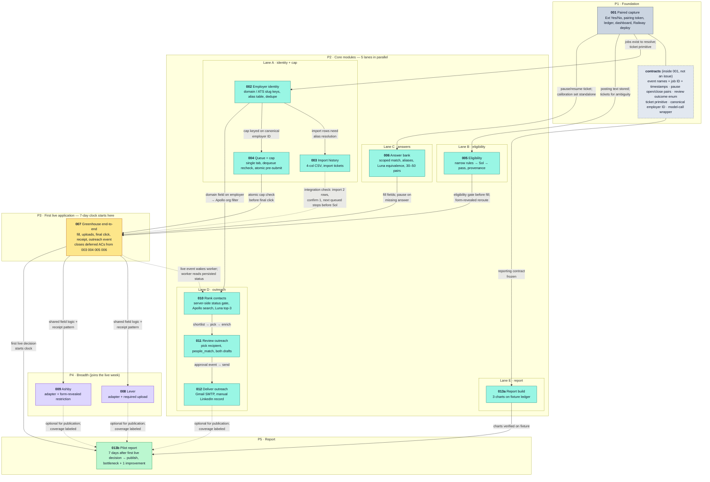

# Build graph

Dependency order for the 13 issues in `issues/`. Arrow labels say why a node must land before the next. Color = phase. Dashed = soft dependency (a fixture stands in until the live piece exists). Arrows are prerequisites, not durations.

Published copy: https://claude.ai/artifact/Td8f7TFshDzxtNLp3RvXVx

## Graph



## Phases

### P1 · Foundation (1 agent, or 2: server / extension)

- Lands: 001. Server, ledger, auth, dashboard shell, Railway. Extension Yes/No.
- Must also freeze the reporting contract: event names carrying job ID and timestamp, pause open/close pairs, review outcome enum, ticket primitive (question, choices, employer, role, resolve action), canonical employer ID shape, one model-call wrapper (provider, model, prompt version, tokens). Every P2 lane consumes these.
- Testable: pair token, Yes saves both URLs and text, No dismisses, wrong-owner token rejected, secrets server-side.

### P2 · Core modules on fixtures (5 agents, one per lane)

- Lane A: 002, then 003 ‖ 004. 003 does not block 004. Its integration check runs in 007.
- Lane B: 005. Standalone module. Replays labeled postings.
- Lane C: 006. Matching core and calibration. Form integration waits for 007.
- Lane D: 010 → 011 → 012. Worker is woken by a fixture event and reads persisted job status before any Apollo call. Send test email to self.
- Lane E: 013a. Three charts against a fixture ledger built from the 001 contract.
- Testable: dedupe, alias merge, CSV import, cap math (clamp, boundary, LA time), eligibility false inclusion/exclusion rates, answer threshold on held-out pairs, Apollo shortlist, enrich, SMTP on a fixture job, uncertain job plus confirmation event produces zero Apollo calls, duplicate event produces one shortlist, chart counts reconcile to fixture.
- Not yet: any real application.

### P3 · First live application (1 agent, converge point)

- Lands: 007 Greenhouse. Wires 004, 005, 006 into one form flow. Emits confirmed event, lane D goes live.
- Closes deferred ACs: 004 cap change before submit blocks the click and an interrupted submit holds the employer; 005 form-revealed restriction reroutes; 006 resumes at the paused field; 003 import two CSV rows, confirm one, next queued job stops before Sol.
- Clock: the first live decision here starts the seven days. Emit `adapter.available` for Greenhouse.
- Testable: one real Greenhouse submission, receipt (selector, text, screenshot, URL), redirect-only creates a hold, outreach ticket appears.

### P4 · Breadth (2 agents, during the live week)

- Lands: 008 Lever and 009 Ashby in parallel. Each emits `adapter.available` when live.
- Testable: 3 ATS replays, Lever required upload, Ashby revealed restriction.

### P5 · Report (no build)

- Lands: 013b seven days after the first live decision, regardless of which adapters or outreach steps are live. Each chart labels its coverage (hosts, outreach, days). 10 passed and 10 excluded sampled, bottleneck and one improvement.
- Testable: the PRD itself.

## Candidate critical path

```
001 → 002 → 004 → 007 → 7 days → 013b
```

008, 009 and 012 are off the path: they join the live week when ready and the report labels their coverage.

Candidate only. Arrows establish prerequisites, not durations. Lane C (006, one L) may run as long as Lane A (M + M). Revisit after 001 lands.

| Issue | Lane | Size | Why |
| --- | --- | --- | --- |
| 001 | P1 | L | Extension + server + auth + deploy + contracts |
| 002 | A | M | Two key schemes, alias table, dedupe fallback |
| 003 | A | S | CSV parse + tickets |
| 004 | A | M | Queue, date math, atomic recheck |
| 005 | B | M | Two pattern lists, Sol call, quote verify, labeled set |
| 006 | C | L | Matching tiers + 30–50 pair calibration + held-out eval |
| 007 | P3 | L | First adapter + integration of three lanes + receipt |
| 008 | P4 | S | Adapter on shared logic |
| 009 | P4 | S | Adapter on shared logic |
| 010 | D | M | Domain resolve, Apollo, gate, idempotency, Luna rank |
| 011 | D | S | Ticket UI + one enrich call |
| 012 | D | S | SMTP + two ledger events |
| 013a | E | M | Three charts + fixture ledger |
| 013b | P5 | S | Run on real ledger, write bottleneck |

## Relations to plan for

| Between | Relation | Do |
| --- | --- | --- |
| 005 · 006 · 010 | All three call OpenAI. Three agents write three wrappers: merge conflict, three logging formats. | One wrapper in 001 contracts. 005 is the first consumer. |
| 002 · 003 · 005 · 006 | All open review tickets. Ticket shape must be shared. | Ticket primitive in 001, not in 002. |
| 001 → 013a | Report reads the ledger. Event names alone are not enough: waiting time needs pause open/close pairs, denominators need review outcomes, the funnel needs job ID and timestamps. | Full reporting contract in 001. 013a is Lane E in P2. |
| 007 → 010 | The fixture event bypasses the real boundary. In production an event is not proof of confirmation. | Event wakes the worker; the worker reads persisted job status. AC: uncertain job plus confirmation event produces zero Apollo calls. AC: duplicate event produces one shortlist. |
| 004 ↔ 007 | 004 ACs "cap change before submit" and "interrupted submit holds" need a real submit. | Tagged "verified in 007" in 004. Listed in 007 ACs. |
| 003 ↔ 007 | A seeded ledger hides identity and date mismatches between imported rows and live jobs. | 007 AC: import two rows via CSV, confirm one, next queued job stops before Sol. |
| 006 ↔ 007 | 006 needs form fields to resume into. Fields come from the 007 adapter. | 006 = matching core and ticket. 007 = field binding and resume check. |
| 002 → 010 | Shared-ATS employers (`greenhouse:acme`) have no domain. Apollo needs one. | 002 adds a `domain` field. 010 fills it via enrich and confirm. |
| 007 → 013b | Seven-day clock ambiguity: P3 goes live before P4 adapters exist. | Clock starts at the first live decision in 007. Each adapter logs `adapter.available`; the report shows per-host coverage. |
| 008 · 009 · 012 → 013b | If any lands on day nine, a hard dependency makes the report two days late. | Soft for publication. Day seven publishes all three charts; missing adapters or outreach read as labeled gaps, not zeros. |

## Blocked-by edits (applied to issue files)

| Issue | Was | Now |
| --- | --- | --- |
| 001 | none | none; ACs gain the contracts checklist |
| 002 | 001 | 001; AC adds `domain` field |
| 003 | 002 | 002; AC adds "integration check runs in 007" |
| 004 | 003 | 002 (003 soft); submit-time ACs tagged "verified in 007" |
| 005 | 004 | 001; AC adds form-revealed reroute "verified in 007" |
| 006 | 005 | 001; AC adds resume-at-field "verified in 007" |
| 007 | 006 | 004, 005, 006 (003 soft); ACs gain deferred checks and clock start |
| 010 | 007 | 002 (007 soft); ACs gain status gate and idempotency |
| 013 | 008, 009, 012 | 013a ← 001; 013b ← 007, 013a (008, 009, 012 soft); ACs add clock rule and day-seven publish with coverage labels |
